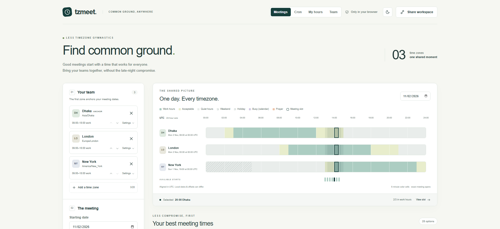
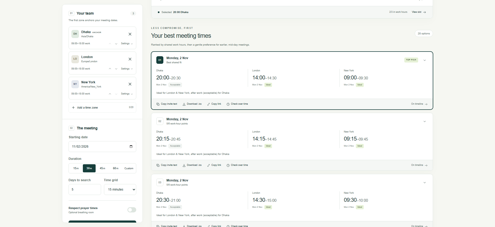

# tzmeet

Find meeting times across time zones, and check cron schedules for daylight saving problems.



## Features

- Ranks meeting times by each city's work hours, weekends, public holidays and, optionally, prayer times.
- Per-city settings: work hours, holidays, date-range hours (such as Ramadan), busy times from `.ics` files and optional attendees.
- Follows weekly meetings through daylight saving changes and suggests times to rotate.
- Explains, converts and checks cron schedules for Unix, Kubernetes, Spring, Quartz, AWS EventBridge, GitHub Actions, Jenkins and systemd.
- Shareable "My hours" and team hours links with an SVG status badge.

## Packages

| Package | Description | Install |
| --- | --- | --- |
| [`tzmeet`](packages/cli) | Command-line tool | `npm install --global tzmeet` |
| [`@tzmeet/api`](packages/api) | REST API ([demo](https://tzmeet-api.onrender.com/docs)) | Docker image |
| [`@tzmeet/core`](packages/core) | Scheduling engine used by the other packages | Source only |
| [`apps/web`](apps/web) | Web app that runs in the browser | [zahidhasann88.github.io/tzmeet](https://zahidhasann88.github.io/tzmeet/) |
| [`action.yml`](action.yml) | GitHub Action for cron checks | [GitHub Marketplace](https://github.com/marketplace/actions/tzmeet-cron-check) |

See each package's README for usage.



## Development

Requires Node.js 22.12+ and pnpm 10.

```sh
git clone https://github.com/zahidhasann88/tzmeet.git && cd tzmeet
pnpm install && pnpm build && pnpm test
```

## License

[MIT](LICENSE). Release history is in [CHANGELOG.md](CHANGELOG.md).
